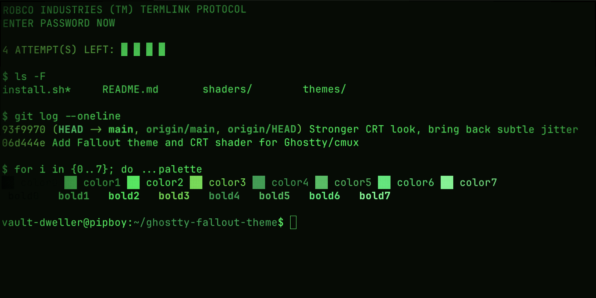
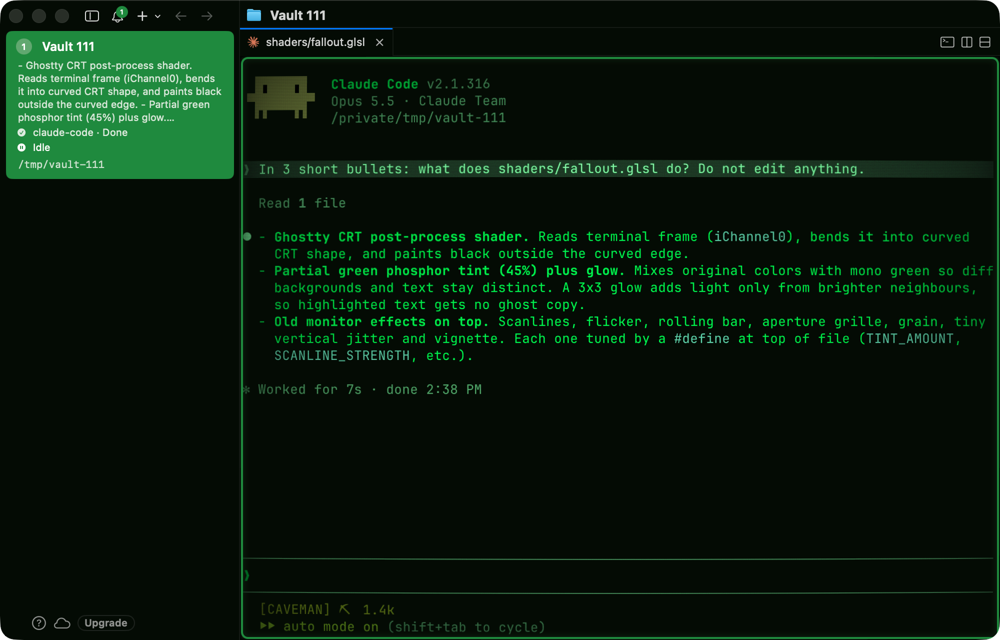

# Fallout theme for Ghostty / cmux

Green phosphor colour theme plus an optional CRT shader (curvature, scanlines, soft glow,
rolling bar, slight jitter, vignette) inspired by Pip-Boy terminals.

The shader is tuned for readability: the glow only spreads from brighter neighbours and the
green tint is partial, so highlighted blocks (e.g. diff backgrounds) stay sharp instead of
showing ghosted text.



Claude Code running in cmux with the green sidebar accent:



## Contents

| File | What it is |
|---|---|
| `themes/Fallout` | Colour theme (background, foreground, cursor, selection, palette 0–15) |
| `shaders/fallout.glsl` | CRT custom shader |
| `install.sh` | Copies both into `~/.config/ghostty` |

## Install

### Built-in theme + shader only

The colours are also submitted to
[iTerm2-Color-Schemes](https://github.com/mbadolato/iTerm2-Color-Schemes) as
**Wasteland Terminal**, the collection Ghostty and cmux ship their built-in themes from.
Once it lands in a release (check with `ghostty +list-themes | grep Wasteland`), you only
need the theme name and the shader file:

```bash
mkdir -p ~/.config/ghostty/shaders
curl -fsSL -o ~/.config/ghostty/shaders/fallout.glsl \
  https://raw.githubusercontent.com/chlp/ghostty-fallout-theme/main/shaders/fallout.glsl
```

Ghostty, `~/.config/ghostty/config`:

```ini
theme = Wasteland Terminal
custom-shader = ~/.config/ghostty/shaders/fallout.glsl
custom-shader-animation = true
```

cmux: run `cmux themes set --dark "Wasteland Terminal"` and add the two `custom-shader*`
lines to the cmux Ghostty config (see [cmux](#cmux) below for its path).

Reload the config with `Cmd+Shift+,` or open a new tab. To tune the shader, edit the
downloaded `fallout.glsl` (see [Tuning the shader](#tuning-the-shader)).

### From this repo

```bash
git clone https://github.com/chlp/ghostty-fallout-theme.git
cd ghostty-fallout-theme
./install.sh
```

Or manually:

```bash
mkdir -p ~/.config/ghostty/themes ~/.config/ghostty/shaders
cp themes/Fallout ~/.config/ghostty/themes/
cp shaders/fallout.glsl ~/.config/ghostty/shaders/
```

#### Ghostty

Add to `~/.config/ghostty/config`:

```ini
theme = Fallout
custom-shader = ~/.config/ghostty/shaders/fallout.glsl
custom-shader-animation = true
cursor-style = block
cursor-style-blink = true
```

#### cmux

Set the theme (cmux reads themes from `~/.config/ghostty/themes`):

```bash
cmux themes set --dark Fallout
```

Then add the shader lines to the cmux Ghostty config:

```bash
open -e "$HOME/Library/Application Support/com.cmuxterm.app/config.ghostty"
```

```ini
custom-shader = ~/.config/ghostty/shaders/fallout.glsl
custom-shader-animation = true
cursor-style = block
cursor-style-blink = true
```

Reload the config with `Cmd+Shift+,` or open a new tab.

Optional: make the cmux sidebar match (green selected workspace instead of cmux blue) by adding
to `~/.config/cmux/cmux.json`:

```json
{
  "app": { "accentColor": "#1F8A3F" },
  "sidebarAppearance": { "darkModeTintColor": "#050B05" }
}
```

Then run `cmux reload-config`.

The theme works without the shader — skip the `custom-shader*` lines for a flat look.

## JetBrains IDEs

The same theme for GoLand, PhpStorm, IntelliJ IDEA and other JetBrains IDEs is available as
**Wasteland Terminal** on [JetBrains Marketplace](https://plugins.jetbrains.com/plugin/35747-wasteland-terminal)
(**Settings -> Plugins -> Marketplace** -> search for "Wasteland Terminal"). Source:
[jetbrains-fallout-theme](https://github.com/chlp/jetbrains-fallout-theme).

## Tuning the shader

Edit the `#define`s at the top of `shaders/fallout.glsl`:

| Parameter | Default | Effect |
|---|---|---|
| `TINT_AMOUNT` | 0.45 | 0 = original colours, 1 = full mono green (hurts contrast) |
| `BLOOM_STRENGTH` | 0.22 | Glow; set 0 if text looks soft |
| `BLOOM_SPREAD` | 1.5 | Glow radius in pixels |
| `SCANLINE_STRENGTH` | 0.26 | Scanline darkness |
| `NOISE_STRENGTH` | 0.035 | Film grain |
| `FLICKER_STRENGTH` | 0.02 | Brightness flicker |
| `CURVE` | 16.0, 13.0 | Screen curvature; higher = flatter |
| `VIGNETTE_STRENGTH` | 0.22 | Dark corners |
| `BAR_INTENSITY` | 0.09 | Rolling bright bar |
| `GRILLE_STRENGTH` | 0.1 | Vertical aperture-grille lines |
| `JITTER_STRENGTH` | 0.00012 | Vertical picture jitter; 0 = stable |

For a stronger retro look try `TINT_AMOUNT 0.6` and `SCANLINE_STRENGTH 0.35`.

Turn off `custom-shader-animation` to stop the flicker / rolling bar and save battery.

## Uninstall

Remove the `theme` / `custom-shader*` lines from the config, then:

```bash
rm ~/.config/ghostty/themes/Fallout ~/.config/ghostty/shaders/fallout.glsl
```

## License

MIT, see [LICENSE](LICENSE).
